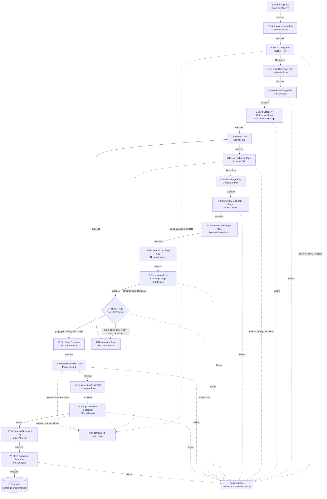

# PoE2 Market Data Pipeline Architecture

## Purpose and current scope

This project uses Apache NiFi to collect PoE2Scout market data once per hour and Cloudflare R2 as its data lake. Each run preserves the original API responses and produces one normalized, analytics-ready `exchange-snapshot.json`.

The pipeline currently stops after publishing the curated exchange snapshot to R2. PostgreSQL, arbitrage calculations, market-mover calculations, and Discord commands that consume the new snapshot format are later phases.

## Technology choices

- **Apache NiFi:** extraction, orchestration, rate limiting, pagination, normalization, and snapshot assembly.
- **Cloudflare R2:** private S3-compatible data lake containing raw, normalized, and curated objects.
- **PostgreSQL:** planned data warehouse for query-ready analytics.
- **FarmerBot:** Discord consumer. During the current transition it can read curated snapshots directly from R2.

## NiFi processor names

The six processors before the existing `7 API Rate Limit` processor should be named as follows:

| Number | Processor name | NiFi component | Responsibility |
|---:|---|---|---|
| 1 | `1 Start Snapshot` | GenerateFlowFile | Start one snapshot run on the configured schedule. |
| 2 | `2 Set Snapshot Metadata` | UpdateAttribute | Create the snapshot ID, timestamp, date, hour, league, and initial page attributes. |
| 3 | `3 Fetch Categories` | InvokeHTTP | Request `Items/Categories` from PoE2Scout. |
| 4 | `4 Set Raw Categories Key` | UpdateAttribute | Build the R2 key for the untouched categories response. |
| 5 | `5 Store Raw Categories` | PutS3Object | Store `categories.json` in the raw R2 layer. |
| 6 | `6 Build Category-Reference Tasks` | ExecuteGroovyScript | Create one task per category and reference currency. |

The complete processor list is:

| Number | Processor name | NiFi component |
|---:|---|---|
| 1 | `1 Start Snapshot` | GenerateFlowFile |
| 2 | `2 Set Snapshot Metadata` | UpdateAttribute |
| 3 | `3 Fetch Categories` | InvokeHTTP |
| 4 | `4 Set Raw Categories Key` | UpdateAttribute |
| 5 | `5 Store Raw Categories` | PutS3Object |
| 6 | `6 Build Category-Reference Tasks` | ExecuteGroovyScript |
| 7 | `7 API Rate Limit` | ControlRate |
| 8 | `8 Fetch Exchange Page` | InvokeHTTP |
| 9 | `9 Set Raw Page Key` | UpdateAttribute |
| 10 | `10 Store Raw Exchange Page` | PutS3Object |
| 11 | `11 Normalize Exchange Page` | ExecuteGroovyScript |
| 12 | `12 Set Normalized Page Key` | UpdateAttribute |
| 13 | `13 Store Normalized Exchange Page` | PutS3Object |
| 14 | `14 Route Page` | RouteOnAttribute |
| 14B | `14B Increment Page` | UpdateAttribute |
| 15 | `15 Set Page Fragment` | UpdateAttribute |
| 16 | `16 Merge Pages Per Task` | MergeRecord |
| 17 | `17 Restore Task Fragment` | UpdateAttribute |
| 18 | `18 Merge Complete Snapshot` | MergeRecord |
| 19 | `19 Set Curated Snapshot Key` | UpdateAttribute |
| 20 | `20 Store Exchange Snapshot` | PutS3Object |

`14B` is a side branch instead of part of the main numbering because it only executes when another API page is required.

## Exact NiFi connections

The following diagram includes the processor component types, relationship names, pagination loop, failure routing, and relationships that should be auto-terminated.



### Connection behavior

- `InvokeHTTP.Response` continues because it contains the API response body used by the next processor.
- `InvokeHTTP.Original` is auto-terminated because the separate response FlowFile continues through this design.
- `Failure`, `Retry`, and `No Retry` currently go to a visible failure queue for inspection and manual replay. Do not create an unlimited automatic retry loop.
- `14 Route Page` uses **Route to Property name**.
  - `page_part = ${has.more.pages:notNull()}` sends every valid normalized page toward assembly.
  - `next_page = ${has.more.pages:equals("true")}` additionally clones a non-final page into the pagination loop.
- `14B Increment Page` sets `page = ${page:toNumber():plus(1)}` and reconnects to `7 API Rate Limit`.
- Both MergeRecord processors continue through `merged`, send `failure` to the failure queue, and auto-terminate `original`.

## R2 data-lake layers

R2 has one bucket with logical layers expressed through object-key prefixes. The apparent directories are prefixes rather than separate physical filesystems.

```text
poe2-data-lake/
  raw/
    poe2scout/v1/league=runes-of-aldur/
      snapshot_id={snapshot_id}/
        categories.json
        ...untouched category/reference API pages...

  normalized/
    poe2scout/v1/league=runes-of-aldur/
      snapshot_id={snapshot_id}/
        ...normalized page arrays...

  curated/
    poe2scout/v1/league=runes-of-aldur/
      dt={yyyy-mm-dd}/hour={HH}/snapshot_id={snapshot_id}/
        exchange-snapshot.json
```

The current final key expression is:

```text
curated/poe2scout/#{pipeline.version}/league=#{league.slug}/dt=${snapshot.date}/hour=${snapshot.hour}/snapshot_id=${snapshot.id}/exchange-snapshot.json
```

The normalized record schema is:

```text
schema_version
snapshot_id
captured_at
realm
league
item_kind
category
api_id
name
reference_currency
current_price
current_quantity
source_page
```

Currency responses identify items with `ApiId`. Unique-item responses instead expose `UniqueItemId` and `ItemId`, so normalization should use a canonical fallback such as:

```groovy
api_id: (item.ApiId ?: item.UniqueItemId ?: item.ItemId)?.toString()
```

FlowFile attributes copied into records should be trimmed:

```groovy
def attr = { String name ->
    flowFile.getAttribute(name)?.trim()
}
```


## Planned analytics and warehouse phase

The curated snapshot is the input for two later transformations:

### Market movers

Compare matching items between consecutive snapshots:

```text
change_percent = ((price_new - price_old) / price_old) * 100
```

Filter or flag missing prices and insufficient quantity, then rank positive changes as gainers and negative changes as losers.

### Arbitrage

Evaluate complete exchange cycles across exalted, chaos, divine, and an intermediate item:

```text
route_factor = rate(A -> B) * rate(B -> C) * rate(C -> A)
theoretical_profit_percent = (route_factor - 1) * 100
bottleneck_volume = minimum liquidity across every route leg
```

Apply configurable safety-margin and minimum-volume rules before publishing an opportunity.

PostgreSQL will eventually hold normalized results such as `market_movers` and `arbitrage_routes`. The Discord bot can then query PostgreSQL for low-latency analytics while R2 remains the durable historical data lake.
